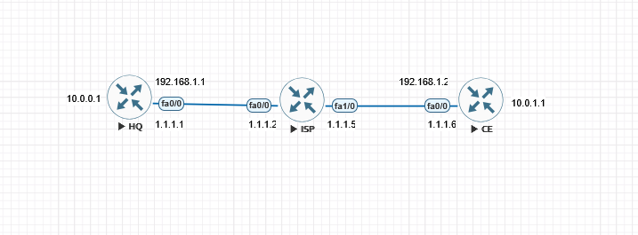
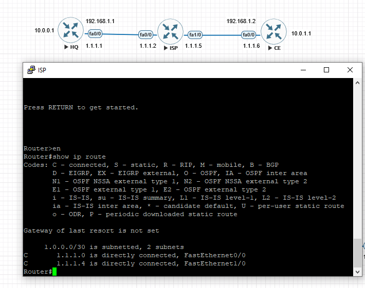
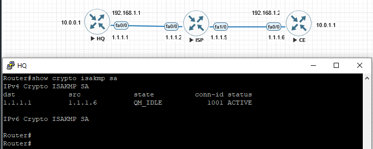
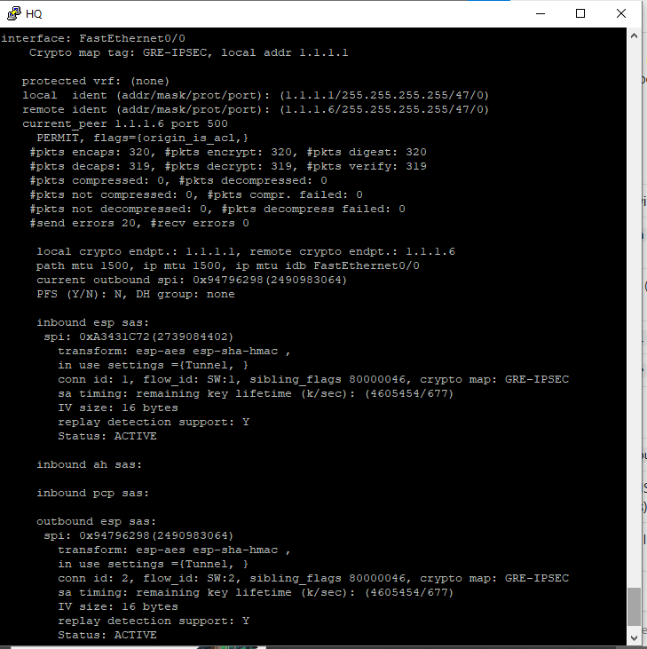
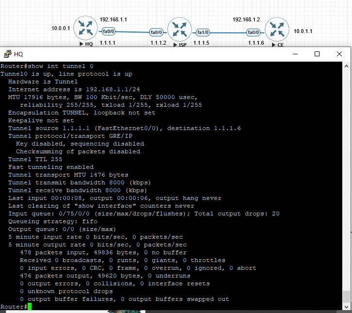
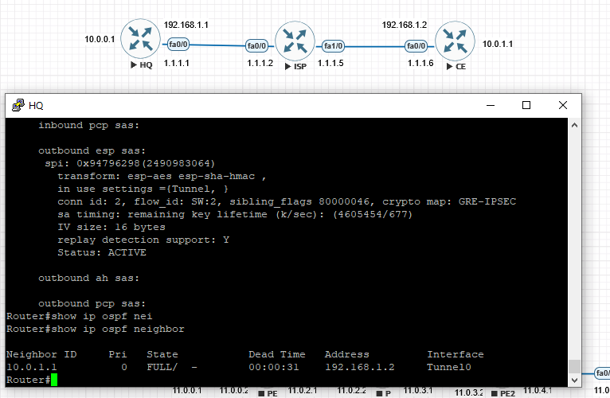
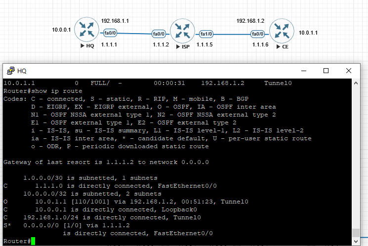
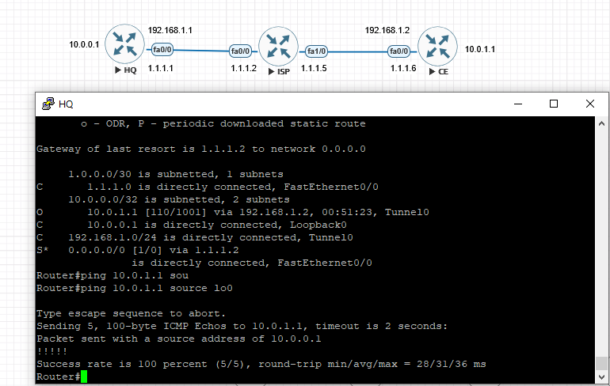

# Site-to-Site VPN Lab: GRE over IPsec

**Two sites connected across an untrusted ISP, where the ISP sees only encrypted packets and knows nothing about the networks inside.**

A lab in EVE-NG where an HQ router and a CE (branch) router are joined by a GRE tunnel, protected with IPsec, and running OSPF over the tunnel. The ISP router in the middle only knows how to reach the two tunnel endpoints.

> A lab environment, built for learning. The pre-shared key used in the lab is weak on purpose and is replaced with a placeholder in this repo.



## The idea

| Question | Answer |
|---|---|
| Why GRE? | IPsec on its own does not carry routing protocols. GRE does, so OSPF can run between the sites. |
| Why IPsec? | GRE has no encryption. IPsec protects the GRE packets so nobody on the path can read them. |
| Why both? | GRE gives a routable tunnel, IPsec gives security. Together they form a secure, dynamic site-to-site VPN. |

## Addressing

| Device | Interface | Address |
|---|---|---|
| HQ | FastEthernet0/0 (to ISP) | 1.1.1.1/30 |
| ISP | FastEthernet0/0 (to HQ) | 1.1.1.2/30 |
| ISP | FastEthernet1/0 (to CE) | 1.1.1.5/30 |
| CE | FastEthernet0/0 (to ISP) | 1.1.1.6/30 |
| HQ | Tunnel0 | 192.168.1.1/24 |
| CE | Tunnel0 | 192.168.1.2/24 |
| HQ | Loopback0 | 10.0.0.1/32 |
| CE | Loopback0 | 10.0.1.1/32 |

## How it works

1. **GRE tunnel:** HQ and CE build a tunnel between their public addresses, 1.1.1.1 and 1.1.1.6.
2. **OSPF over the tunnel:** both routers run OSPF (process 1, area 0) on Tunnel0 and on their loopbacks, so each learns the other's loopback.
3. **IPsec protection:** a crypto map on the physical interface matches the GRE traffic between the two endpoints and encrypts it with ESP.

### IPsec design

| Item | Value |
|---|---|
| IKE (phase 1) | Pre-shared key authentication, AES, Diffie-Hellman group 5, SHA |
| IPsec (phase 2) | Transform set `SECRET`: `esp-aes` with `esp-sha-hmac` |
| Traffic selected | `permit gre host 1.1.1.1 host 1.1.1.6` (mirrored on the CE) |
| Applied on | Crypto map `GRE-IPSEC` on FastEthernet0/0 of both routers |

### HQ configuration excerpt

The pre-shared key is replaced with a placeholder.

```
crypto isakmp policy 10
 encr aes
 authentication pre-share
 group 5
crypto isakmp key <PRE-SHARED-KEY> address 1.1.1.6
!
crypto ipsec transform-set SECRET esp-aes esp-sha-hmac
!
crypto map GRE-IPSEC 10 ipsec-isakmp
 set peer 1.1.1.6
 set transform-set SECRET
 match address LIST
!
interface Loopback0
 ip address 10.0.0.1 255.255.255.255
 ip ospf 1 area 0
!
interface Tunnel0
 ip address 192.168.1.1 255.255.255.0
 ip ospf 1 area 0
 tunnel source FastEthernet0/0
 tunnel destination 1.1.1.6
!
interface FastEthernet0/0
 ip address 1.1.1.1 255.255.255.252
 crypto map GRE-IPSEC
!
router ospf 1
 log-adjacency-changes
!
ip route 0.0.0.0 0.0.0.0 1.1.1.2
!
ip access-list extended LIST
 permit gre host 1.1.1.1 host 1.1.1.6
```

## What the ISP sees

The ISP router only has the two networks it is directly connected to. It has no route to the loopbacks (10.0.0.x, 10.0.1.x) or to the tunnel network (192.168.1.0/24), and the traffic it forwards between 1.1.1.1 and 1.1.1.6 is encrypted ESP. The internal routers, the OSPF messages and the loopback traffic are all hidden inside the tunnel.



## Verification

### IPsec is up

IKE phase 1 is established between the two peers:



IPsec phase 2 security associations, with packets being encrypted and decrypted:



### The GRE tunnel is up



### OSPF runs over the tunnel



The CE loopback is learned through Tunnel0:



### End-to-end test

A ping between the loopbacks goes through the tunnel:



## Troubleshooting note

While configuring, HQ logged messages saying it received a packet that was **not an IPsec packet** with protocol 47, which is GRE. This happened because GRE traffic arrived before the crypto map was applied on the other router, so it was not protected yet. After the crypto map was applied on both ends, the OSPF neighbor went from LOADING to FULL and the tunnel started carrying routes. This shows that both peers must match: the same policy, the same key, and mirrored ACLs.

## Ideas to improve it

- Use a strong pre-shared key, or certificates, instead of a short lab key.
- Use IPsec transport mode for GRE to reduce the overhead.
- Rebuild it with an IPsec tunnel interface (VTI) and compare.
- Capture traffic on the ISP link with Wireshark to show ESP packets next to a GRE-only capture.

## What I learned

- Building a GRE tunnel and running a routing protocol over it
- Configuring IKE and IPsec with a crypto map, and matching traffic with an ACL
- Verifying a VPN with `show crypto isakmp sa`, `show crypto ipsec sa` and tunnel and OSPF checks
- Reading syslog messages to troubleshoot a mismatched IPsec setup
- Why the transport network never needs to know the internal addressing

## Author

Ezzaldien Osman, Junior Network Engineer
LinkedIn: [linkedin.com/in/ezzaldeen-osman-mohamed](https://linkedin.com/in/ezzaldeen-osman-mohamed)
